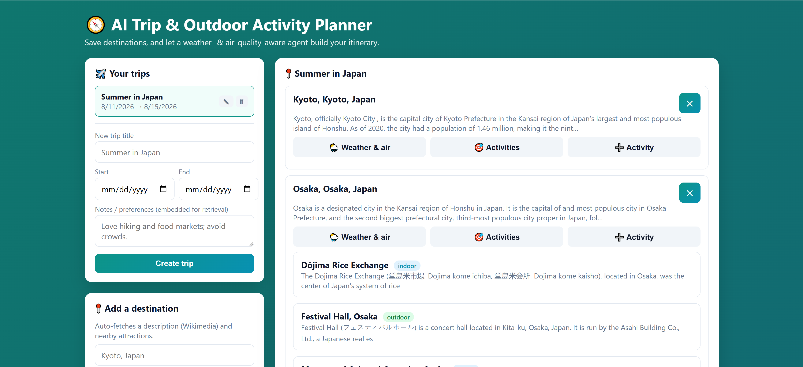
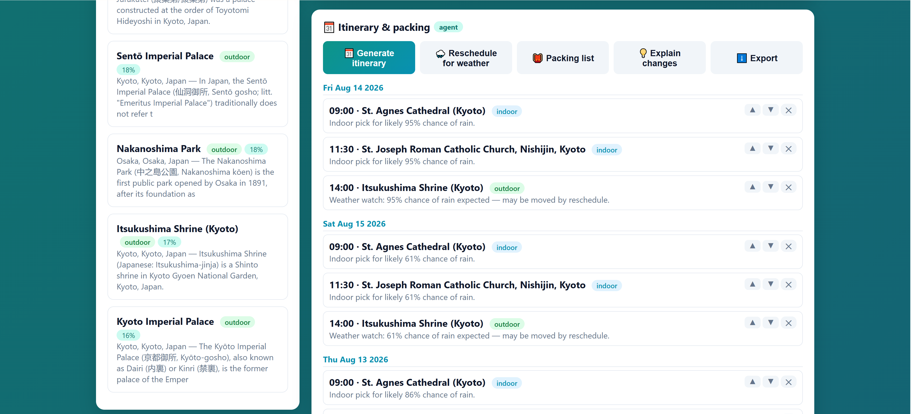
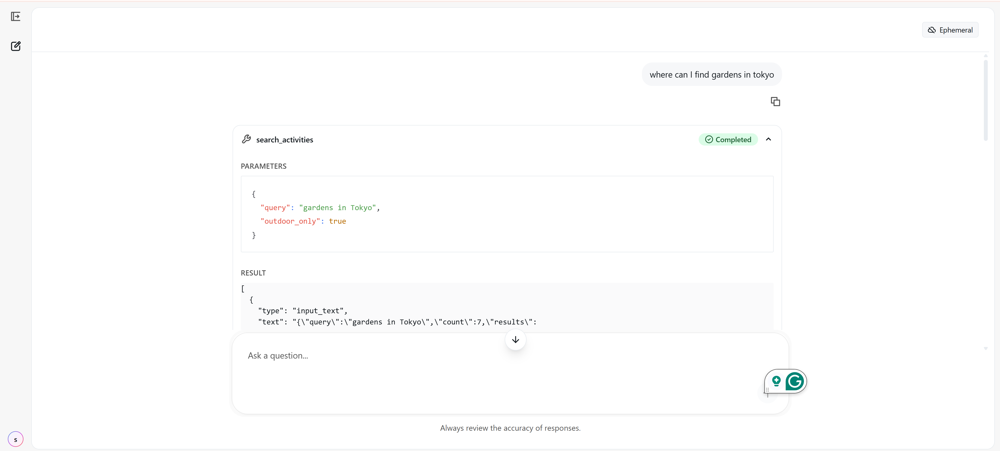

# 🧭 AI Trip &amp; Outdoor Activity Planner

> A weather- and air-quality-aware trip planner with an AI agent, built end-to-end on
> **Databricks + Lakebase (Postgres + pgvector)**.

Save destinations and preferences, and an **AI agent** builds a day-by-day itinerary, **reschedules
outdoor activities** when rain or poor air quality is forecast, generates a **packing list**, edits
the plan, and **explains every weather-based decision** — grounding all of it in real forecasts and
its own vector search over destination/attraction descriptions.

Built as a Databricks AI bootcamp capstone, synthesizing Lakebase + pgvector retrieval, the FastMCP +
**Agent Bricks** pattern, key-less Open-Meteo/Wikimedia integrations, and a Spark embedding pipeline.

**Live:** two agent surfaces — an in-app chat *and* a Databricks Agent Bricks agent over MCP — both
deployed and driving the same tool layer.

## Screenshots

| Trip planner | Weather-aware itinerary | Agent Bricks + MCP |
|---|---|---|
|  |  |  |

<!-- Drop your PNGs into docs/screenshots/ with these names (see docs/screenshots/README.md). -->

## Features

- 🗺️ **Trip management** — create, edit, and delete trips; add/remove destinations (auto-fetches a
  Wikimedia description + nearby attractions); add your own custom activities.
- 🌦️ **Weather + air quality** — daily forecast, US AQI, PM2.5, UV and pollen per destination
  (Open-Meteo), stored as `weather_snapshots`.
- 🗓️ **Weather-aware itinerary** — a day-by-day plan that schedules indoor options on bad-weather
  days; reorder items, or move/remove them.
- 🌧️ **Automatic rescheduling** — moves outdoor activities off rainy / poor-AQI days and records the
  reason, then **explains** the changes in plain language (Foundation Model).
- 🎒 **Smart packing list** — derived from the forecast + your activities (rain → umbrella, high UV →
  sunscreen, cold → layers…), with an interactive checklist.
- 🔎 **Semantic search** — pgvector cosine search over embedded destinations/attractions/notes.
- 💬 **Two AI agents, one tool layer** — an in-app chat agent and an Agent Bricks agent over MCP.
- ⬇️ **Export** — download the itinerary + packing list as Markdown.
- 📊 **Usage analytics** — app events logged to Lakebase, with a Spark notebook that reads them
  (JDBC) and computes an engagement funnel and event mix into Delta bronze + gold tables.

## The 6 required capstone components

| Component | Where |
|---|---|
| **1. Spark data pipeline** | [`notebooks/ingest_place_embeddings.py`](notebooks/ingest_place_embeddings.py) — Spark DataFrame + `pandas_udf` embeds text at scale into a governed Delta gold table. |
| **2. Third-party API integration** | Four **key-less** APIs in [`clients/`](clients/): Open-Meteo Geocoding / Weather / Air Quality + Wikimedia summaries + GeoSearch. |
| **3. Unstructured-data processing** | Descriptions, attraction text, and notes chunked + embedded (384-dim MiniLM) into `place_embeddings` (pgvector). |
| **4. Databricks App with a frontend** | [`app.py`](app.py) + [`templates/index.html`](templates/index.html), served as a Databricks App. |
| **5. Agent that retrieves AND writes** | [`planner_tools.py`](planner_tools.py) — pgvector retrieval **and** DB writes (itinerary/reschedule/packing), via an in-app agent and a FastMCP/Agent Bricks agent. |
| **6. Analytics in a Delta table about the app** | [`analytics.py`](analytics.py) logs usage events to Lakebase `app_events`; [`notebooks/app_analytics.py`](notebooks/app_analytics.py) reads them with Spark (JDBC) and writes **Delta** bronze + gold analytics (event mix, funnel, daily activity) with charts. |

Full traceability: [`docs/capstone_requirements_mapping.md`](docs/capstone_requirements_mapping.md).

## Architecture

```
                         ┌──────────────────── Databricks App (Flask) ────────────────────┐
  Browser  ────────────▶ │  app.py  ──▶  planner_tools.py  ──▶  Lakebase (Postgres+pgvector) │
   (index.html)          │      │              │        │                                    │
                         │      │              │        └──▶ clients/ ──▶ Open-Meteo, Wikimedia
                         │      └─ /agent/chat ─┴─ agent.py (Foundation Model tool-calling)  │
                         └────────────────────────────────────────────────────────────────┘
                                        ▲
   Agent Bricks agent ──(MCP tool calls)┘   mcp_server/planner_mcp_server.py (same planner_tools)

   Spark: notebooks/ingest_place_embeddings.py ──▶ Delta gold ──(/embeddings/refresh)──▶ pgvector
```

More in [`docs/architecture.md`](docs/architecture.md).

## Data model (Lakebase / Postgres)

The seven required tables plus a pgvector context store, created idempotently by
`lakebase.ensure_all_tables()` (reference DDL in [`sql/`](sql/)):

`users` · `trips` · `destinations` · `activities` · `itinerary_items` · `weather_snapshots` ·
`packing_items` · **`place_embeddings`** (VECTOR(384), HNSW cosine index).

## Key engineering decisions

Real platform constraints, diagnosed and handled honestly — each documented:

- **Two-phase embeddings (Spark → Delta, App → pgvector).** Free-edition Serverless can't write
  Lakebase via `psycopg2`/Spark-JDBC, so the heavy batch embedding runs in **Spark → Delta**
  (Serverless-safe) and the App writes the pgvector serving copy. See
  [`docs/spark_pipeline_and_serverless.md`](docs/spark_pipeline_and_serverless.md).
- **Best-effort index DDL.** The app runs whether it or another Postgres role owns the tables —
  index creation is skipped-and-logged on "must be owner" rather than failing the request
  (`lakebase._try_ddl`).
- **Multi-layer base64 URL decode.** Databricks injects secret-backed env vars base64-encoded (and
  `setup_secrets.py` also encodes), so the connection string can be **double**-encoded — the resolver
  peels layers until it reaches a `postgresql://` URL (`lakebase._maybe_decode`).
- **Off-platform enrichment for the Serverless DNS block.** Serverless can't resolve
  `en.wikipedia.org`, so Wikimedia enrichment runs from a box with egress
  ([`scripts/enrich_destinations.py`](scripts/enrich_destinations.py)) and writes into Lakebase.
  See [`docs/serverless_egress_and_enrichment.md`](docs/serverless_egress_and_enrichment.md).
- **Graceful agent fallback.** If a workspace's model endpoint can't tool-call, the in-app agent
  falls back to deterministic keyword routing — it never hard-fails.

## Setup

**1. Lakebase secret** (the only secret — every data API is key-less):
```bash
python setup_secrets.py     # prompts for the Lakebase URL, stores it base64-encoded
```

**2. Local run:**
```bash
pip install -r requirements.txt
cp .env.example .env         # set LAKEBASE_URL, or rely on a configured Databricks CLI profile
python app.py                # http://localhost:8000
```

**3. Deploy as a Databricks App:** push to a Git folder, then **Compute → Apps → Create app →
Custom**, point it at this folder (it reads `app.yaml`), and Deploy.

**4. Spark pipeline (optional):** run [`notebooks/ingest_place_embeddings.py`](notebooks/ingest_place_embeddings.py)
on a Serverless notebook, then `POST /embeddings/refresh` to load vectors into Lakebase.

**5. Agent Bricks (second agent surface):** deploy [`mcp_server/`](mcp_server/) as its own app and
follow [`mcp_server/agent/agent_setup.md`](mcp_server/agent/agent_setup.md).

## API

| Method + path | Purpose |
|---|---|
| `GET/POST /trips`, `GET/PATCH/DELETE /trips/<id>` | create / list / edit / delete trips (delete cascades) |
| `GET/POST /trips/<id>/destinations`, `DELETE /destinations/<id>` | manage destinations |
| `GET/POST /destinations/<id>/activities` | list / add activities |
| `POST /destinations/<id>/weather` | fetch forecast + AQI → `weather_snapshots` |
| `GET /weather?location=`, `GET /air?location=` | raw forecast / air-quality reads |
| `POST /embeddings/refresh`, `POST /search` | embed new text / semantic search |
| `GET /trips/<id>/itinerary`, `POST …/itinerary/generate`, `POST …/itinerary/reorder` | itinerary |
| `POST /trips/<id>/reschedule`, `GET /trips/<id>/explain` | weather rescheduling + explanations |
| `GET/POST /trips/<id>/packing`, `POST /packing/items/<id>/toggle` | packing list + check off |
| `POST /trips/<id>/itinerary/items`, `POST /itinerary/items/<id>/move`, `DELETE /itinerary/items/<id>` | itinerary item CRUD |
| `POST /agent/chat` | talk to the in-app planner agent |

## Tests

`tests/test_planner_tools.py` — an integration smoke test that runs the whole tool path
(create → destination → weather → embed → retrieve → itinerary → reschedule → packing → explain → CRUD)
against a live Lakebase and cleans up after itself:

```bash
DATABRICKS_CONFIG_PROFILE=weather-app python tests/test_planner_tools.py
```

## Repo layout

```
app.py                planner_tools.py   agent.py        llm.py        embedding_job.py
lakebase.py           embeddings.py      clients/        templates/    sql/
notebooks/            mcp_server/         scripts/        tests/        docs/
```

## Credits &amp; data sources

Open-Meteo (weather, air quality, geocoding) and Wikimedia — free for non-commercial use, no API key.
Built on Databricks Lakebase + Apps + Foundation Model APIs.
